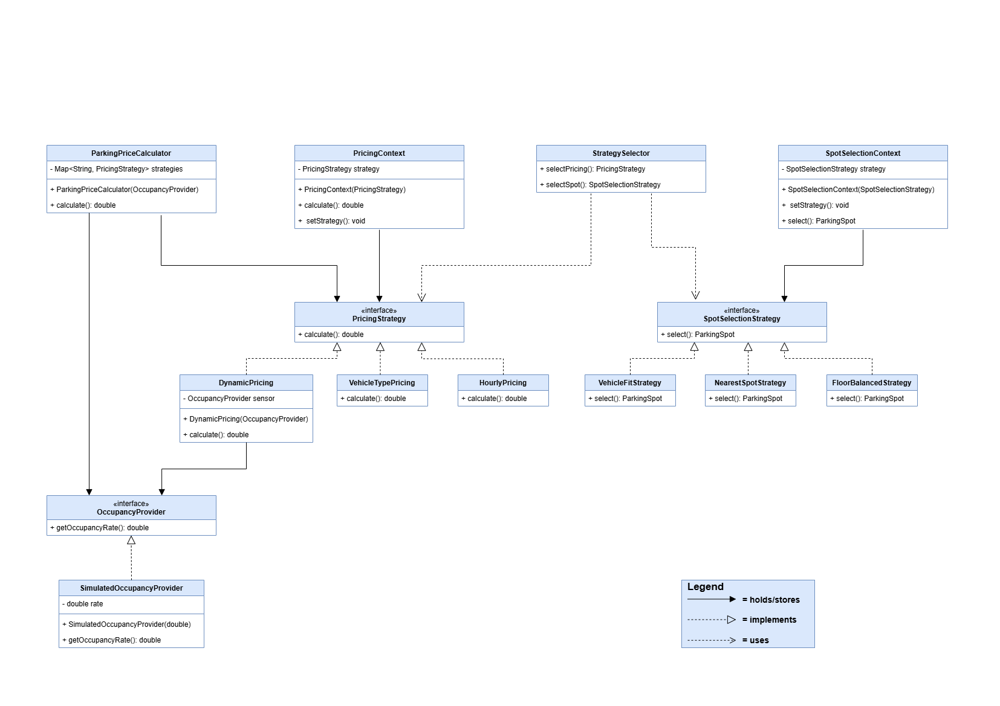

## Project Overview
Smart Parking Garage is an application that simulates a smart parking garage. The application calculates parking fees and selects suitable parking spaces using interchangeable algorithms.
The project demonstrates the Strategy Design Pattern through two independent strategy families. It supports manual strategy selection, automatic selection based on garage conditions, and runtime strategy switching.

## Classes and Responsibilities 
| Class | Single Responsibility |
|---|---|
| Vehicle | Stores vehicle identification details |
| ParkingSpot | Represents a parking space with its physical properties |
| ParkingSession | Stores the vehicle parking session details |
| OccupancyProvider | Defines an abstraction for garage occupancy measurements |
| SimulatedOccupancyProvider | Supplies simulated garage occupancy values |
| PricingStrategy | Defines the parking fee calculation contract |
| HourlyPricing | Calculates parking fees based on started hours |
| VehicleTypePricing | Calculates parking fees based on vehicle size |
| DynamicPricing | Calculates parking fees using occupancy measurements |
| ParkingPriceCalculator | Provides a compatibility entry point for pricing strategies |
| SpotSelectionStrategy | Defines the parking space selection contract |
| NearestSpotStrategy | Selects the nearest suitable available parking space |
| FloorBalancedStrategy | Selects parking spaces based on floor occupancy |
| VehicleFitStrategy | Selects parking spaces based on vehicle capacity requirements |
| PricingContext | Delegates parking fee calculations to the active strategy |
| SpotSelectionContext | Delegates parking space selection to the active strategy |
| StrategySelector | Selects appropriate strategies based on garage conditions |
| Main | Demonstrates the SmartGarage application |
| PricingContractTest | Verifies the behavior of pricing strategies |
| PricingRefactoringTest | Verifies consistent pricing results across refactoring versions |
| SpotStrategyTest | Verifies the behavior of parking space strategies |
| SelectorTest | Verifies automatic strategy selection rules |

## Strategy Pattern UML Diagram

## Why Strategy Instead of State or Template Method?
The Strategy Pattern is used because the system needs interchangeable algorithms for pricing and parking spot selection.
Parking fee calculation can be performed using different approaches. 
HourlyPricing calculates fees based on parking duration, VehicleTypePricing considers vehicle size, and DynamicPricing uses garage occupancy information. 
Although all three algorithms produce a parking fee, their calculation logic is different.

The same principle applies to parking space selection. One algorithm prioritizes distance, another balances parking across floors, and another minimizes unused parking capacity. 
These algorithms implement a shared interface, making them interchangeable without changing the context class.

Strategy uses composition instead of inheritance. The context receives a strategy object through its constructor and delegates the operation to that object. 
The setStrategy() method makes it possible to replace an algorithm during program execution. This approach supports the Open/Closed Principle because new algorithms can be introduced without modifying existing contexts.

State Pattern is not appropriate because it models behavior changes caused by an object's internal state and state transitions. 
SmartGarage does not model pricing algorithms as lifecycle states. Instead, the application deliberately selects an algorithm based on business requirements or current garage conditions. The algorithms remain independent of each other.

Template Method Pattern is also less suitable. Template Method defines a fixed algorithm structure in a superclass and allows subclasses to customize individual steps. 
SmartGarage does not require a shared algorithm skeleton. Its pricing and parking space algorithms have different implementations, making composition through strategy interfaces more flexible than inheritance.

Therefore, Strategy provides the clearest design for SmartGarage by separating algorithms from their usage, supporting runtime replacement, and reducing coupling between components.

## Refactoring History
Before Refactoring:
https://github.com/wishiwereey/smart_garage_strategy/commit/18125621c11323e05da43d9c2cf7b9d9ba03ee3e

After Refactoring:
https://github.com/wishiwereey/smart_garage_strategy/commit/6be0c63418ebe843b3e8584df5c06e95d2477d9e

## Conclusion
SmartGarage demonstrates two independent Strategy Pattern families through interchangeable algorithms.
The application supports automatic strategy selection, runtime switching, isolated external data access, and JUnit 5 testing.
The refactoring history demonstrates the transition from conditional pricing logic to a more maintainable object-oriented design.